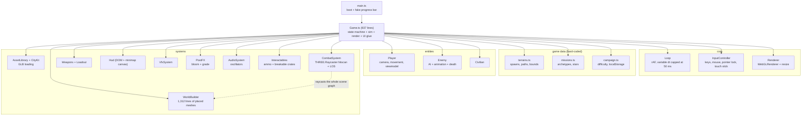
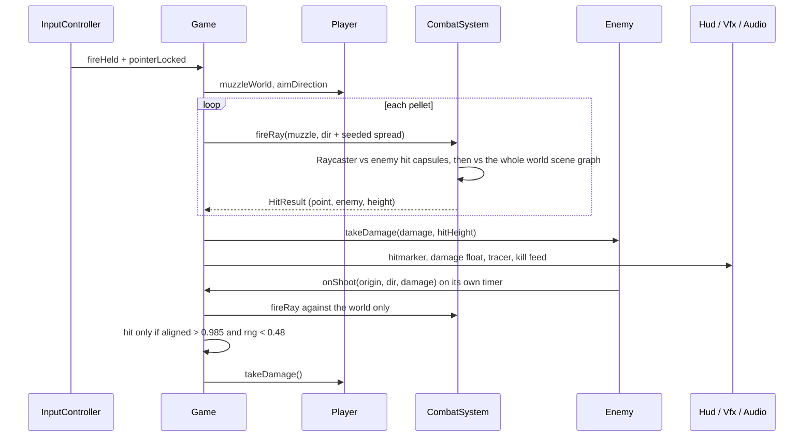

# Codebase review: the original Dusty Duty

Scope: `/home/user/google-game-test`, a single commit (`d425383`, "Add Dusty Duty WebGL game for GitHub Pages hosting"). Every file in `src/` was read, and `dist/` was inspected for bundle and asset sizes. Figures marked *(lead)* were measured by the project lead in headless Chromium with SwiftShader and were not re-measured here. This review is the baseline for the [gap analysis](05-gap-analysis.md); the rewrite it motivates is described in the [v2 architecture](06-architecture.md).

## 1. At a glance

| Item | Value |
|---|---|
| Stack | Three.js 0.184 (WebGL2), Vite 8, TypeScript 6 (strict), Playwright 1.60 |
| Size | `src/` is 7,565 lines: 6,547 TS in 27 files plus 1,018 CSS. About 8.4k with `index.html`, tests and scripts. |
| Content | 3 missions (Sun Market, Orchard Fields, Ridge Road), 4 enemy archetypes, 5 hitscan weapons, 3 difficulties (recruit, veteran, dust = night), civilians, breakable crates, ammo crates |
| Meta | 1 to 3 stars per mission, sequential unlock, `localStorage` key `dusty-duty-campaign-v1` |
| Assets | 6.45 MB in `public/assets`. Only 3.4 MB is loaded: `Soldier.glb` 2.16 MB, `FpsRig.glb` 0.87 MB, 14 Kenney city tiles 0.37 MB. `Xbot.glb` (2.93 MB) and `collision-world.glb` (95 KB) are never referenced. |
| Bundle | One 777 KB JS chunk. Source maps are on, so `dist/` is 11 MB. |
| Boot | 27.7 s under SwiftShader *(lead)*. 16 sequential GLB fetches happen before the menu appears. |
| Tests | One Playwright smoke test (`tests/visual.spec.ts`). `bot-playtest.template.ts` and `visual-regression.template.ts` are unused templates. |
| CI | `.github/workflows/deploy-pages.yml`: `npm ci`, `npm run build`, deploy. It runs no tests. |

## 2. Architecture

`Game.ts` (937 lines) owns everything: the state machine, entity spawning, combat orchestration, HUD synchronisation, campaign saves and test diagnostics. Simulation and rendering share one object graph, so gameplay state lives inside Three.js objects (`Enemy.group.position` is the enemy's position).

### Game loop

`core/Loop.ts` runs one `requestAnimationFrame` callback that calls `Game.update(dt)` and then `Game.render()`.

- `dt = min((now - last) / 1000, 0.05)`. There is no fixed step. Below 20 fps, game time runs slower than wall time. On 120 and 144 Hz displays the simulation runs at display rate.
- Match states: `menu`, `countdown` (3.2 s), `playing`, `paused`, `won`, `lost`.

Per-frame order in `Game.update` while `playing`:

1. Resize check, then atmosphere, world animator, VFX and HUD ticks. The sun shadow camera is re-centred on the player.
2. Pause key handling.
3. `loadout.update`, weapon switch, `player.update` (movement, viewmodel), footsteps, ammo pickup.
4. Reload, then fire if the trigger is held **and the pointer is locked** (`Game.ts:657`).
5. Every enemy: `Enemy.update` (AI, movement, shooting), which asks `CombatSystem.hasLineOfSight` once per frame while engaged.
6. Civilians, secondary objective, win and lose checks, `syncHud`, `publishDiagnostics`.
7. `Game.render`: `EffectComposer` runs RenderPass, UnrealBloom, a grade shader and OutputPass.

### Data flow

## 3. Systems

| File | Lines | Responsibility |
|---|---:|---|
| `main.ts` | 59 | Boot sequence. The progress percentages are hard-coded. |
| `core/Loop.ts` | 31 | rAF loop, dt clamp |
| `core/Renderer.ts` | 39 | `WebGLRenderer` setup (ACES, `PCFSoftShadowMap`), DPR-capped resize |
| `core/InputController.ts` | 254 | Keyboard, mouse under pointer lock, on-screen stick and fire button |
| `game/Game.ts` | 937 | Everything not listed below |
| `game/campaign.ts` | 106 | Difficulty table, save and load, star recording, unlock order |
| `game/missions.ts` | 131 | Archetype stats, mission definitions, star formula |
| `game/terrains.ts` | 190 | Hard-coded spawn points, patrol paths, bounds |
| `entities/Player.ts` | 361 | Camera, walk and sprint, AABB collision, viewmodel sway, ADS, visual recoil |
| `entities/Enemy.ts` | 564 | Detection, chase, shoot, hit reactions, death animations, AABB collision |
| `entities/Civilian.ts` | 135 | Waypoint walking and fleeing. Cannot be shot. |
| `systems/WorldBuilder.ts` | 1,312 | Builds the three terrains from hand-placed meshes and procedural textures |
| `systems/CityKit.ts` | 149 | Loads 14 Kenney GLB tiles one after another and places them at fixed coordinates |
| `systems/AssetLibrary.ts` | 173 | Loads `Soldier.glb` and `FpsRig.glb`, clones skinned meshes |
| `systems/CombatSystem.ts` | 120 | `THREE.Raycaster` hitscan and line-of-sight |
| `systems/Weapons.ts` | 336 | Weapon table, `Loadout` ammo state, procedural viewmodels |
| `systems/Hud.ts` | 352 | DOM HUD, minimap canvas, kill feed, damage floats |
| `systems/VfxSystem.ts` | 293 | Muzzle flash, tracers, impact and blood particles, dust motes |
| `systems/Atmosphere.ts` | 170 | Preetham sky, sun, haze sheets, distant mountains, dust banks |
| `systems/PostFX.ts` | 113 | Bloom, vignette, grain, chromatic fringe, heat haze |
| `systems/AudioSystem.ts` | 134 | Oscillator and filter one-shots, no spatialisation |
| `systems/Interactables.ts` | 192 | Ammo crates and breakable crates at fixed positions |
| `systems/ProceduralTextures.ts`, `WorldAnimator.ts` | 221, 87 | Canvas textures, tarp and laundry sway |
| `styles.css`, `index.html` | 1,018, 216 | All menus and HUD |

## 4. Content

| Mission | Bounds (m) | Hostiles | Civilians | Secondary | Par |
|---|---|---|---:|---|---:|
| Sun Market | 56 × 56 | 6: 2 rifleman, 2 rusher, 1 breacher, 1 marksman | 2 | Hold the plaza 12 s | 180 s |
| Orchard Fields | 68 × 42 | 6: 2 rifleman, 1 rusher, 1 breacher, 2 marksman | 3 | Reach the north extract | 200 s |
| Ridge Road | 32 × 48 | 7: 1 rifleman, 2 rusher, 2 breacher, 2 marksman | 1 | Reach the lookout | 220 s |

- **Stars.** 1 star for a win. 2 stars for par time with at least 28% accuracy, or for the secondary objective. 3 stars for both. The civilian condition is `civiliansSafe: true` in `Game.finishWin` (`Game.ts:544`). Civilians are not in the raycast target list, so they cannot be hurt.
- **Weapons.** Carbine (34 dmg, ~630 rpm, 30/90), SMG (18, ~1,090 rpm, 40/120), Shotgun (7 × 18, ~83 rpm, 6/24), Sidearm (26, semi, 15/60), Marksman (52, semi, 12/48). Zone multipliers: head 1.55, abdomen 1.25, chest 1.0, legs 0.8.
- **Archetypes.** Rifleman 100 hp, Rusher 80 hp at 6.2 m/s, Breacher 110 hp with 5 pellets, Marksman 70 hp with 18 damage and a 48 m range.
- **Difficulty.** Recruit 0.85× enemy health and 0.7× enemy damage. Dust is 1.2× health, 1.3× damage, night lighting, 0.85× ammo.
- **Authoring.** Missions are coordinates typed into `terrains.ts`, `CityKit.decorate`, `Interactables.place` and `WorldBuilder`. Adding a fourth mission means editing four files by hand. Total replay value is roughly 3 missions × 3 minutes.

## 5. Strengths

1. **Readable, small modules.** Apart from `Game.ts` and `WorldBuilder.ts`, files are 30 to 560 lines with clear names.
2. **Hit reactions are good.** Zone-based damage, stagger, four death styles, gut-shot fold, damage floats, hit marker and kill feed.
3. **Visual polish for the size.** PBR materials, image-based lighting, a warm grade with heat haze, dust motes, and a night difficulty that changes the whole look.
4. **Clean licensing record.** `ATTRIBUTION.md` lists each asset source and license.
5. **Sensible difficulty axes.** Health, damage, speed, aggro range, ammo and lighting are all tuned per difficulty.
6. **Test hooks exist.** `__THREE_GAME_DIAGNOSTICS__` and `__THREE_GAME_TEST_HOOKS__` (seed, set state, freeze) are the right idea.
7. **Robust save handling.** `loadCampaign` guards `JSON.parse` and missing fields.
8. **A real deploy path.** Pushing to `main` publishes to GitHub Pages.

## 6. Issues, ranked

### Critical

| ID | Issue | Evidence | Impact and direction |
|---|---|---|---|
| C1 | **The deployed build cannot load its assets.** Asset URLs are absolute (`/assets/...`) but the Pages build sets Vite `base` to `/Google-Game-test/`. Both GLTF loaders 404, `bootstrap` rejects, and the boot screen stays on "Load failed, see console". Reproduced by serving a `GITHUB_PAGES=true` build under `/Google-Game-test/` *(lead)*. | `AssetLibrary.ts:37`, `:50`; `CityKit.ts:48`; `vite.config.ts:5`; `main.ts:56-59` | The live game does not start. Use `import.meta.env.BASE_URL` or relative URLs, and show a real error with a retry. v2 ships no external assets and uses `base: './'`. |
| C2 | **Phones and tablets cannot aim or fire.** Look input exists only in `onMouseMove` behind `pointerLocked`. The touch layer is a move stick and a fire button. Fire is gated on `isPointerLocked()`, which never becomes true on browsers without touch pointer lock (iOS Safari). Where lock does succeed, finger drags produce no `movementX/Y`, so the view cannot turn. | `InputController.ts:76-80`; `Game.ts:657`; `index.html:207-211` | Mobile is unplayable, and touch support blocks a portal's mobile slot. Needs a drag-to-look zone, an independent fire path and aim assist. Verify on real devices. |

### High

| ID | Issue | Evidence | Impact and direction |
|---|---|---|---|
| H1 | **Enemy AI is a beeline.** No pathfinding: enemies walk straight at the player and are pushed out of buildings by AABB resolution, so they get stuck on walls. Perception is a radius. Line of sight only gates shooting. Any enemy inside 0.65 × engage range is permanently aggro. A hit alerts every enemy within 28 m of the one hit. No cover use, flanking or squad behaviour. | `Enemy.ts:157-181`, `:192-194`, `:535-564`; `Game.ts:484-489` | Fights are predictable and the map collapses onto the player. Needs nav, cover, sight cones and a director. |
| H2 | **Enemy hits are dice rolls.** A shot hits only if the player is nearer than the world hit, the aim is within about 10°, and `rng() < 0.48`. Geometry, movement and cover do not decide the outcome. | `Game.ts:801-806` | Dodging and cover are unreliable. Enemy bullets are real rays in v2. |
| H3 | **Slow, heavy boot.** 16 GLB requests are awaited in series (`CityKit.load` loops with `await`), 3.4 MB of GLBs plus 777 KB of JS, and 3 MB of unused assets is shipped. 27.7 s under SwiftShader *(lead)*. | `CityKit.ts:44-56`; `AssetLibrary.ts:37-50`; `public/assets` | Portals want under 8 MB initial and a load under 10 s, and top games load faster (see [market research §4](research/02-market-and-video-research.md)). |
| H4 | **The first minute is unfair or confusing.** Every mission resets yaw to 0 (looking toward -Z). In Orchard Fields all six hostiles (z ≥ 14) and the extract (z = 28) are behind a player at z = 10, and the player faces the -Z map edge, 18 m away. On Ridge Road the nearest hostile is 4 m from spawn and the second is 8 m. | `Player.ts:285-288`; `terrains.ts` | Bad first impression on two of three missions. The only grace is a 4 s no-shoot window (`spawnGuard`). |
| H5 | **Thin, hard-coded content.** About 9 minutes of total play, one objective pattern, positions typed by hand. | `terrains.ts`, `WorldBuilder.ts`, `CityKit.ts:60-110` | Portals want 10+ minutes of average playtime ([market research §4](research/02-market-and-video-research.md)). Needs generation, seeds and modes. |
| H6 | **Nothing catches regressions.** One smoke test that loads `/`. The deploy workflow never runs tests. The Playwright web server serves the site at the root, so the Pages base path is never exercised, which is why C1 shipped. | `deploy-pages.yml`; `playwright.config.ts:14-21`; `tests/visual.spec.ts` | Add headless sim tests, a bot playtest against the built site under its real base path, and gate deploy on them. |

### Medium

| ID | Issue | Evidence |
|---|---|---|
| M1 | **Simulation and rendering are coupled, on a variable timestep.** Game state lives in Three.js objects and behaviour depends on frame rate. A headless test, replay or server is impossible. | `Loop.ts:25`; `Game.ts` |
| M2 | **Hit tests walk the whole scene graph.** `Raycaster.intersectObjects(root, true)` runs once per pellet (7 for the shotgun) and once per engaged enemy per frame for line of sight, over about 1,200 geometries on Market *(lead)*. No BVH or spatial index. Cost not profiled here. | `CombatSystem.ts:43`, `:69`, `:81`; `Game.ts:669` |
| M3 | **Shots start at the muzzle, not the eye.** The crosshair and the shot line diverge at close range. Recoil is a camera and viewmodel offset only, so there is no recoil to control. | `Game.ts:724`; `Player.ts:269-273` |
| M4 | **No settings.** Sensitivity is a constant (`0.0022`), FOV is fixed at 72, master volume is a constant, there are no keybinds and no gamepad. `reducedMotion` is reachable only from a test hook. | `InputController.ts:29`; `Player.ts:221`; `AudioSystem.ts:4`; `Game.ts:890` |
| M5 | **Not reproducible.** The seeded RNG covers the player's spread and the 48% roll only. `Math.random` is used in enemy fire cadence and spread, death style, particles, camera shake, animation phase and HUD offsets. Enemy hit flash resets in `window.setTimeout`, which ignores pause and reset. | `Enemy.ts:122`, `:197-207`, `:308`; `VfxSystem.ts`; `Player.ts:317` |
| M6 | **Diagnostics mislead.** `renderer.info` is read in `update`, after the composer's final full-screen pass has reset the counters, so it reports `calls = 1`, `triangles = 1`. | `Game.ts:819`, `:900` |
| M7 | **The AKM viewmodel covers 25 to 30% of the screen** *(lead)*, at scale 0.085 and offset (0.12, -0.22, -0.28). | `AssetLibrary.ts:142-144` |
| M8 | **One 777 KB chunk, source maps in production.** No vendor split, so every code change invalidates the Three.js cache. | `vite.config.ts` |

### Low

| ID | Issue | Evidence |
|---|---|---|
| L1 | Civilians have no stakes: they cannot be hit and the star check is hard-coded. | `Game.ts:544`; `CombatSystem.ts:50-60` |
| L2 | The boot progress bar is fake: 8, 28, 45 are set on frame ticks, not on work done. | `main.ts:26-33` |
| L3 | Dead weight: `Xbot.glb`, `collision-world.glb`, and the `lil-gui` dependency, which is never imported. | `public/assets`; `package.json` |
| L4 | `FpsRig.glb` is MIT plus CC-BY, but no credit is shown in-game. | `ATTRIBUTION.md` |
| L5 | `Space` is `preventDefault`ed and `'MouseRight'` is checked as a key, but there is no jump and the key is never set. | `InputController.ts:46`, `:186` |
| L6 | README says the dev server is "often 5205", but the config pins 5188. | `README.md`; `vite.config.ts` |

## 7. What carries forward

The rewrite keeps the mission-plus-stars shape, the hit-zone model, the difficulty axes, the warm desert look and the idea of test hooks. It replaces the structure: a headless deterministic simulation, generated levels, real AI, and no external assets. See the [gap analysis](05-gap-analysis.md) for the dimension-by-dimension comparison.
