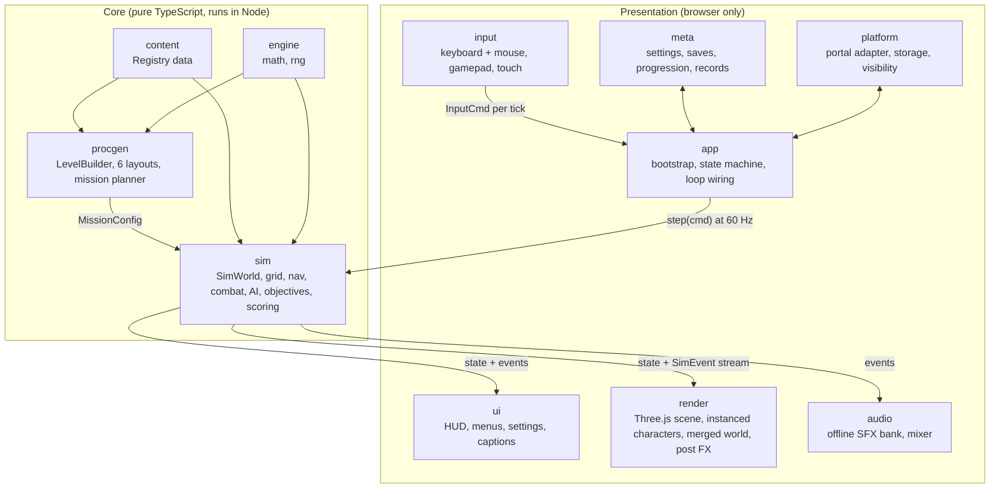
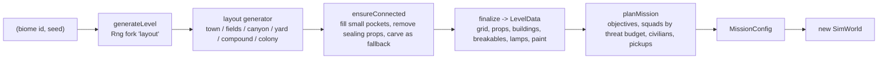
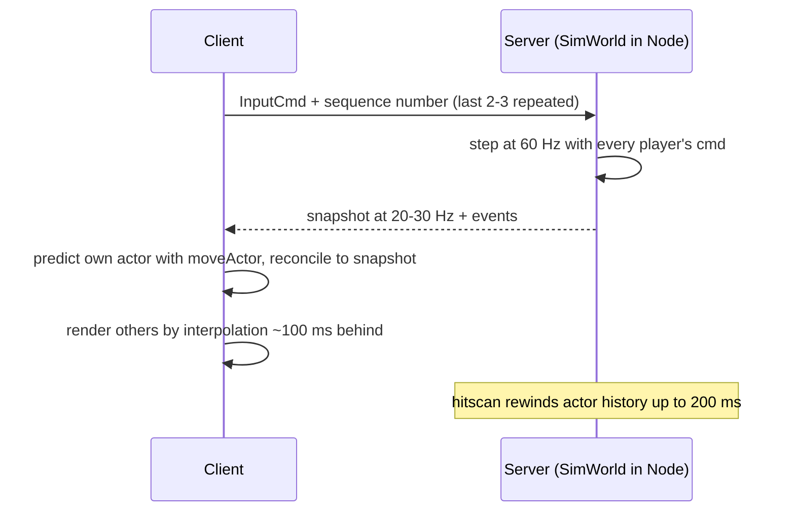

# v2 architecture

Dusty Duty v2 is a rewrite around one idea: **the game is a pure function of a mission config and a stream of input commands.** A headless simulation owns all gameplay. Everything with a browser dependency (rendering, audio, devices, menus) reads the simulation's state and events and never writes to it. This is what makes daily seeds, bot playtests, replay verification and a future authoritative server possible without a second implementation.

Status tags: **built** means present in `src/` when this was written; **(being implemented)** means the folder was empty or partial. Numbers cited from the [tech research](research/04-tech-research.md) are marked as such. Why the rewrite was needed is in the [codebase review](01-codebase-review.md).

## 1. Layers



Dependencies point downward only. `sim`, `procgen`, `content` and `engine/{math,rng}` must not import `three`, DOM types or any presentation folder. Vitest runs in a Node environment, so DOM access in the core throws under test. Importing `three` would not, so a lint rule (`no-restricted-imports`) is recommended but not yet added. `engine/loop.ts` is browser-only (it uses `requestAnimationFrame`).

## 2. Folder map

| Folder | Contents | Status |
|---|---|---|
| `engine/` | `math.ts` (conventions, cone sampling), `rng.ts` (sfc32, seed codes, daily seed), `loop.ts` (fixed-step loop) | built |
| `content/` | `types.ts`, `registry.ts`, `weapons.ts` (player weapons, AI variants, 9 attachments), `actors.ts` (7 enemies, 4 factions), `biomes.ts` (6), `campaign.ts` (12 ops in 3 chapters, 6 contract types), `rules.ts` (4 difficulties, 7 perks, 9 modifiers), `index.ts` (registries, cross-checks, `resolveWeapon`) | built |
| `sim/` | `types.ts` (`InputCmd`, `Actor`, `SimEvent`), `world.ts`, `grid.ts`, `nav.ts`, `movement.ts`, `combat.ts`, `objectives.ts`, `scoring.ts`, `mission.ts`, `level.ts`, `bot.ts`, `ai/brain.ts`, `ai/director.ts` | built |
| `procgen/` | `builder.ts` (`LevelBuilder`, connectivity repair), `common.ts`, `layouts/{town,fields,canyon,yard,compound,colony}.ts`, `mission.ts` (`generateLevel`, `planMission`, mode builders) | built |
| `input/` | `Input.ts` (all devices to `InputCmd`, remapping, aim assist), `touch.ts` | built |
| `audio/` | `dsp.ts` (offline synthesis), `sfxdefs.ts` (45 sound ids), `types.ts`; mixer and engine | partly built |
| `meta/` | `settings.ts` (validated settings); progression, saves, v1 migration | partly built |
| `render/` | `util.ts`; scene, world meshing, characters, viewmodels, post FX | (being implemented) |
| `ui/`, `app/`, `platform/` | HUD and menus; bootstrap and state machine; Poki and CrazyGames adapter | (being implemented) |
| `tests/unit`, `tests/e2e` | Vitest (Node) for core; Playwright for boot and bot playtests | unit built, e2e (being implemented) |

Conventions: metres, Y up, 1 m grid cells, yaw 0 looks toward -Z and positive yaw turns left, positive pitch looks up (matches a Three.js camera with rotation order YXZ).

## 3. Key abstractions

### InputCmd

The only way anything acts on the world. Players, AI brains, the test bot and (later) network clients all produce it.

```ts
interface InputCmd {
  moveF: number; moveR: number;   // local-space axes, -1..1
  yaw: number; pitch: number;     // absolute look, radians
  buttons: number;                // Btn bitmask: Fire, Ads, Jump, Crouch, Sprint, Reload, Interact, Grenade, Next, Prev
  slot: number;                   // 0 = no change, else weapon slot + 1
}
```

Edges are detected in the sim from `buttons & ~prevButtons`. `Input.buildCmd` is called once per tick and latches momentary presses so a tap between two ticks is never lost. Look angles update immediately from device events so the camera can read them every frame. AI brains write `actor.cmd` directly; the sim treats both the same.

### SimWorld

`new SimWorld(config: MissionConfig)` builds navigation, spawns squads, civilians and pickups, and starts the objectives.

| Member | Behaviour |
|---|---|
| `step(playerCmd)` | Advance exactly `DT = 1/60`. No-op once `status` leaves `running`. |
| `hash(): number` | FNV-style hash of tick, actors (id, position, yaw, hp, alive, ammo), projectiles, RNG state and score, quantised to millimetres. For determinism tests, replay verification and desync detection. |
| `snapshot()` | Compact view: tick, status and per-actor `{id, kind, x, y, z, yaw, hp, alive}`. Not a restorable save (see section 10). |
| `drainEvents(out)` | Moves queued `SimEvent`s into `out` and clears the queue. Capped at 6,000. |
| `status`, `endReason` | `running`, `success` or `failed`, with a reason string. |

The grid is mutated by destruction (`damageCell`), so **each run needs a fresh `MissionConfig`**. Regenerating is cheap (2 to 23 ms measured).

### SimEvent stream

A tagged union of 28 data-only events: `shot`, `damage`, `kill`, `reload`, `switch`, `jump`, `land`, `step`, `slide`, `throw`, `bounce`, `explosion`, `break`, `whiz`, `bark`, `pickup`, `interact`, `charge`, `objective`, `medal`, `wave`, `spawn`, `laser`, `alert`, `missionEnd` and a few more. Consumers:

| Consumer | Uses |
|---|---|
| render | tracers, impacts by surface, debris on `break`, hit reactions, death poses |
| audio | `shot` by weapon and surface, `step` by surface, `whiz`, `explosion`, `bark` |
| ui | kill feed, hit markers, damage direction, captions from `bark`, medals, wave banners |
| meta | stars, XP, records, daily results (from `missionEnd` and final stats) |
| network (later) | forwarded to clients |

Stars, par time and bonus conditions are evaluated outside the sim from its final stats; the sim never reads `mode`, `parTime` or `bonus`.

### `Registry<T>`

```ts
class Registry<T extends { id: string }> {
  register(item: T): T          // throws on duplicate id or failed validate()
  get(id: string): T            // throws on unknown id
  maybe(id?: string): T | undefined
  all(): readonly T[]           // stable registration order
  indexOf(id: string): number   // stable numeric index for compact snapshots
}
```

Nine registries exist: `Weapons`, `Attachments`, `Enemies`, `Factions`, `Biomes`, `Difficulties`, `Perks`, `Modifiers`, `Campaign`. Validators run at registration (positive damage and rpm, valid range, biome at least 40 × 40 m). Cross-references (enemy to weapon, biome to faction and roster, op to biome) are checked when `content/index.ts` loads, so a typo fails at boot or in unit tests. Systems look content up by string id only.

### LevelBuilder to LevelData



Generation is pure: the same `(biome, seed)` gives the same map. `GENERATOR_VERSION` is mixed into the seed. Bump it whenever a change alters existing outputs, because shared seed codes and the Daily Op depend on stability. Layout generators return the spawn, candidate sites, hold zones and extraction zones. `planMission` places objectives by path distance from spawn, keeps general squads at least 22 m from spawn, and holds back marksmen and juggernauts from the first 35% of the path distance.

### Director and Brain

- **Brain** (`sim/ai/brain.ts`) runs per enemy. It perceives and decides every 6th tick (10 Hz, staggered by a per-actor phase), then steers, aims and shoots every tick by writing an `InputCmd`. States: idle, patrol, investigate, combat, search, flee, cower, captive, follow. Tactics: cover, advance, flank, rush, hold, retreat.
- **Director** (`sim/ai/director.ts`) runs once per tick. It resets the path budget (8 queries), assigns attack tokens every 6 ticks and flankers every 30, rebuilds the shared flow field when the player changes cell (at most every 20 ticks), spawns queued reinforcements and runs Last Stand.

## 4. Tick order

`SimWorld.step` runs these phases in a fixed order:

1. Increment the tick and store previous position and yaw on every actor and projectile (used for render interpolation).
2. Copy the clamped player command onto the player actor.
3. Fire delayed squad alerts.
4. `director.update`.
5. Every living brain: `updateBrain` writes that actor's `cmd`.
6. For each actor in array order (the player is first): timers, `moveActor`, `updateWeapons` (which fires and traces shots), footstep events and noise, health regeneration.
7. Actor separation, then projectiles, pending explosions, pickups, interactables.
8. Camp detection (drives AI grenade decisions), `objectives.update`, corpse cap (40).
9. End check: player dead, objective failure or all objectives complete. Calls `scoring.finalize` and emits `missionEnd`.

## 5. Determinism rules

1. No `Math.random`, `Date`, `performance.now`, timers or DOM in `sim/` and `procgen/`. A search finds only default `new Date()` arguments in `dailySeed` and `dailyInfo`, which the app layer calls.
2. All randomness comes from seeded `Rng` streams: `world.rng` (combat, drops), `world.aiRng` (forked), the generator's `fork('layout')` and the planner's own stream. Presentation code uses its own generators and never draws from a sim stream.
3. Time is the tick count. Frame time never enters the sim.
4. Iterate arrays in order and break ties by actor id (the director's token sort does).
5. Ids come from a counter.
6. Anything that must match across machines is hashed after quantisation (`q()`).
7. Known limit: `sin`, `cos`, `atan2`, `pow` and `hypot` (about 29 call sites) are not guaranteed identical across JavaScript engines. Replays are exact for one build on one engine. A server-authoritative design does not need cross-engine bit-exactness.

Checked ad hoc in this container: two runs of three campaign ops with a scripted bot, and one Last Stand, produced identical hashes every 60 ticks; a different seed produced different hashes. A permanent test is still to be added.

## 6. Why a heightfield, not a physics engine or BVH

`sim/grid.ts` is one set of typed arrays (height, surface, flags, shape, radius, hp, floor) on a 1 m grid. It serves collision, hitscan, line of sight, navigation, cover analysis, the minimap and world meshing.

- **Exact and cheap.** A ray is a grid walk (Amanatides and Woo) with an analytic height test per cell, so cost is proportional to the cells crossed, not to scene complexity. Round pillars are handled as cylinders.
- **No dependency.** Per the [tech research](research/04-tech-research.md), Rapier is 1.17 MB gzipped, Jolt 742 KB, three-mesh-bvh 16 KB.
- **Serialisable and hashable.** Plain typed arrays, with a `version` counter that invalidates nav and cover caches when a crate breaks.
- **Renderer-independent.** Visual props and buildings are descriptors in `LevelData`; meshing them is the renderer's job.

Costs: one height per cell (no overhangs, bridges or upper floors), 1 m resolution, axis-aligned solids, ramps only as step-ups (0.45 m), no dynamic rigid bodies. Callers use `raycast`, `lineOfSight`, `heightAt` and `walkable`, so a layered grid or a lazily loaded physics engine for props could replace it locally.

## 7. WebGL2 now, and the WebGPU gate

The tech research finds `WebGPURenderer` still described as experimental in the three.js manual, about 110 KB gzipped heavier, and about 2x the CPU per object in one forum benchmark (r183, single source). `WebGLRenderer` is universal, works in headless CI, and is enough for a stylised scene of under 60 draw calls. All Three.js code lives in `render/`, so a second backend replaces one folder.

Adopt WebGPU only when all of these hold (item 2 comes from the tech research; the rest are proposed):

1. The three.js manual no longer calls `WebGPURenderer` experimental, and our materials and post effects have supported equivalents.
2. On the reference low-end Android phone and on iOS 18 and 26, the WebGPU build holds 60 fps at render scale 0.75 or higher with at most 150 draw calls (from the tech research).
3. CPU frame time is within 10% of the WebGL2 build on the same scene and devices.
4. The added download fits the size budget.
5. A CI path without WebGPU still works.
6. A feature we want, such as cascaded shadows or GPU-driven particles, does not fit the WebGL2 budget.

## 8. Performance budgets

| Metric | Mobile | Desktop |
|---|---|---|
| Draw calls, including shadow pass | 120 or fewer (typical target under 60) | 250 or fewer |
| Triangles | 250k or fewer | 1M or fewer |
| Pixel ratio cap | 1.5 | 2.0 |
| Shadow map | 1024² or off | 2048² |
| Sim tick with 60 enemies | 2 ms or less | 1 ms or less |
| Download | under 400 KB gzipped in total, zero asset bytes | same |
| Boot to menu | under 5 s | under 5 s |

Dynamic resolution (planned): more than 2 s over frame budget drops render scale by 0.1, to a floor of 0.5; more than 5 s comfortably under raises it again.

Sim guards in code: 8 path queries per tick, 10 Hz brains, flow field rebuilt at most every 20 ticks, 40 corpses, 6,000 queued events.

**Measured in Node on this container** (bot-driven, warm JIT, not a phone): campaign ops averaged 0.11 to 1.5 ms per tick with up to 27 actors. Three-minute Last Stand runs on all 6 biomes averaged 0.09 to 0.42 ms, p99 1.75 to 10.2 ms, worst tick 66 ms, with 12 to 16 hostiles alive at peak. The 60-enemy budget is unmeasured, and the tail needs profiling.

## 9. Extending the game

**Add a weapon.**
1. Append a `WeaponDef` to `WEAPONS` in `content/weapons.ts`: unique `id`, `slot`, `cls`, damage and range falloff, `rpm`, magazine, spread, `recoil` profile, `audio` profile, `model` spec, `unlockLevel`.
2. Registration validates positive damage, rpm and magazine, and `rangeEnd > rangeStart`.
3. If it needs a new silhouette, add a builder for its `model.build` id in `render/`.
4. Allow attachments by listing its class in each `AttachmentDef.classes`.
5. For an AI variant, add `aiVariant('ai_x', 'base', {...})` and point an enemy at it.
6. Run `npm test`. The sim needs no change.

**Add an enemy.** Add an `EnemyDef` to `ENEMIES` (weapon id must exist). Reusing an existing `role` is data-only; a new role needs a branch in `decide()` in `brain.ts`. Add it to a biome's `roster` weights or a campaign op's `special` list. Add a `THREAT_COST` entry in `procgen/mission.ts` (default 1). A new `headgear` value needs a mesh in `render/`.

**Add a biome.** Add a `BiomeDef` (size at least 40 × 40, existing faction, roster ids that exist, palette, sky, ambience, reverb). Reference it from campaign ops as needed. The existing procgen tests loop over `Biomes.all()`, so it is checked for connectivity and determinism automatically (update the `Biomes.size` assertion). For a new layout style: extend `LayoutStyle`, write `layoutX(b: LevelBuilder): LayoutResult` in `procgen/layouts/`, and register it in the `LAYOUTS` map in `procgen/mission.ts`. Return the spawn, sites, holds and extracts, and rely on `ensureConnected`.

**Add an objective kind.**
1. Add it to `ObjectiveKind` in `content/types.ts` and any fields to `ObjectiveSpec`.
2. In `sim/objectives.ts`: setup in `start()` and `activate()`, its state machine in `update()`, and HUD markers in `markers()`.
3. In `procgen/mission.ts`: a placement case in `planMission` and a label in `objectiveLabel`.
4. Add a contract type in `content/campaign.ts` so Contracts and Daily Ops can use it.
5. Extend the "every contract type places reachable objectives" test.

**Add a mode.** Modes are `MissionConfig` producers. Add the id to `GameMode`, write a builder in `procgen/mission.ts` that calls `planMission` with a `recordKey`, then add the menu entry (`ui/`) and its records (`meta/`). The sim needs no change.

## 10. Multiplayer path

The target is an authoritative Node server running the same `SimWorld`, starting with co-op Last Stand because the AI stays server-side.



| In place | Missing |
|---|---|
| Sim runs headless in Node (Vitest proves it) | World takes one player command and assumes one player in 36 places across 6 files (`world`, `combat`, `objectives`, `brain`, `director`, `bot`) |
| `InputCmd` drives every actor | Full-state serialise and restore (brains, director, objectives, projectiles, RNG), needed for reconciliation and late join. `snapshot()` covers actors only. |
| Previous-tick state on actors for interpolation | Hitbox history ring buffer for lag compensation |
| Events as data; `hash()` for desync detection | Wire format, delta compression, transport, rooms |
| `moveActor` is a standalone function with no world dependency, usable for client prediction | Per-player scoring, loadouts and objective credit |
| RNG state readable and settable; registry `indexOf` for compact ids | Anti-cheat rate limits on look and fire |

Bandwidth estimate (mine, unverified): about 10 bytes per actor quantised, 60 actors at 20 Hz is about 12 KB/s, inside the 20 KB/s downstream budget from the tech research before delta compression.
